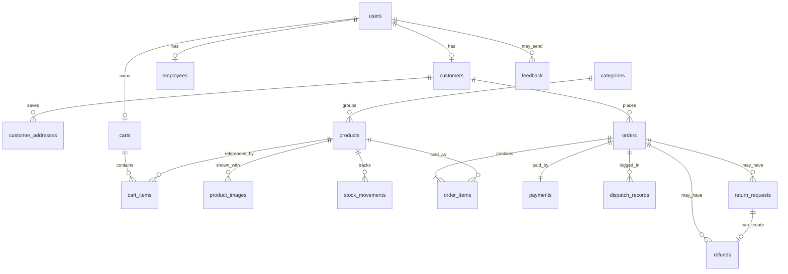

# Database Schema and ER Diagram

Database name: `paperlane_shop`. The full script is `database.sql`. Identifiers that must keep leading zeros are `CHAR`, not integers.

## Tables

| Table | Purpose | Important columns |
| --- | --- | --- |
| users | Every login | role (`admin`, `employee`, `customer`), email unique, password_hash, status |
| customers | Customer profile | user_id unique, references users |
| customer_addresses | Delivery addresses | customer_id, address fields, is_default |
| employees | Staff profile | user_id unique, employee_code unique, designation |
| categories | Catalogue groups | code_prefix unique CHAR(2), slug unique, image, status |
| products | Items for sale | product_code unique CHAR(7), price, stock, warranty_info, featured, status |
| product_images | Up to four photos | file_name, is_primary |
| stock_movements | Every stock change | change_qty, balance_after, reason |
| carts | One cart per customer | user_id unique |
| cart_items | Lines in that cart | unique (cart_id, product_id), quantity |
| order_counters | One row, id = 1 | last_seq, used to issue the next sequence |
| orders | One customer order | order_number unique CHAR(16), delivery_type, primary_product_code, totals, order_status, payment_status, dispatch_date, delivery_date |
| order_items | Lines copied at purchase | product_code, product_name, unit_price, quantity |
| payments | One payment per order | method, amount, status, card_last4, txn_reference, cheque fields |
| dispatch_records | Dispatch and delivery notes | action, employee_id nullable, actor_user_id required, notes, action_date |
| return_requests | Return or replacement | request_type, status, reason, admin_notes |
| refunds | Shop refund record | amount, status `pending` or `issued`, return_id nullable |
| feedback | Customer notes | name, email, subject, message, rating, status |
| faqs | Public questions | question, answer, sort_order, status |

Stock reasons are `opening`, `adjustment`, `order`, `cancel`, `return` and `replacement`.

Order status is `pending`, `confirmed`, `dispatched`, `delivered` or `cancelled`.

Payment status is `pending`, `verified`, `cleared`, `failed` or `refunded`.

## Relationships

- A user has at most one customer row or one employee row.
- A customer has many addresses, and orders point at the customer. The address text is also copied onto the order so a later address edit does not rewrite history.
- A category has many products. A product has many images and many stock movements.
- A customer user has one cart. A cart has many items.
- An order has many items, one payment, many dispatch records, and may have return requests and refunds.
- `order_counters` is not a child of orders. It is a single counter row locked while a number is issued.

## ER diagram

`order_counters` and `faqs` stand alone. Feedback may have a null user when a visitor is not logged in.

## Order number stored on `orders`

`order_number` is CHAR(16). `delivery_type` is the first character. `primary_product_code` is the next seven characters and must match the lowest `product_code` among `order_items`. The last eight digits are the counter. Example: `1010000100000001` is card, product `0100001`, sequence 1.
