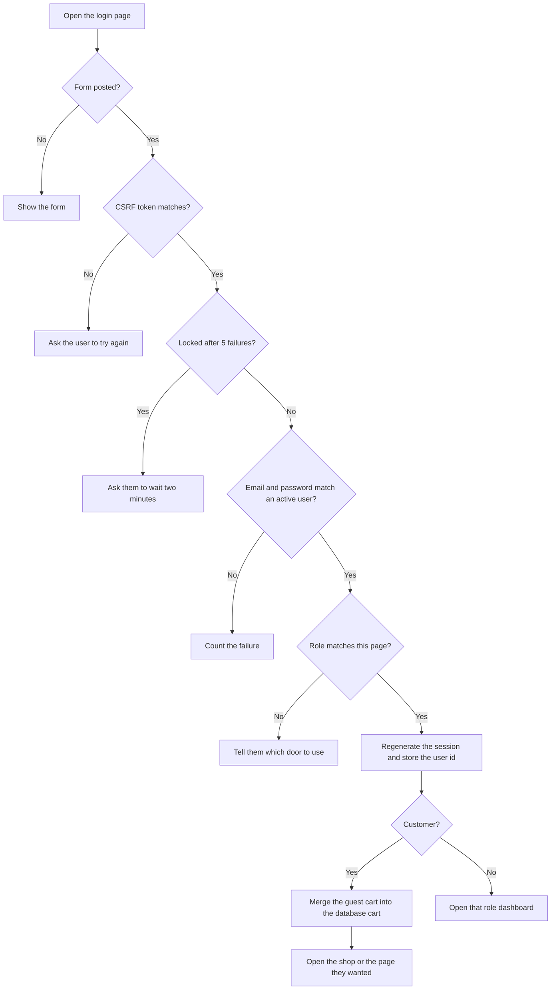
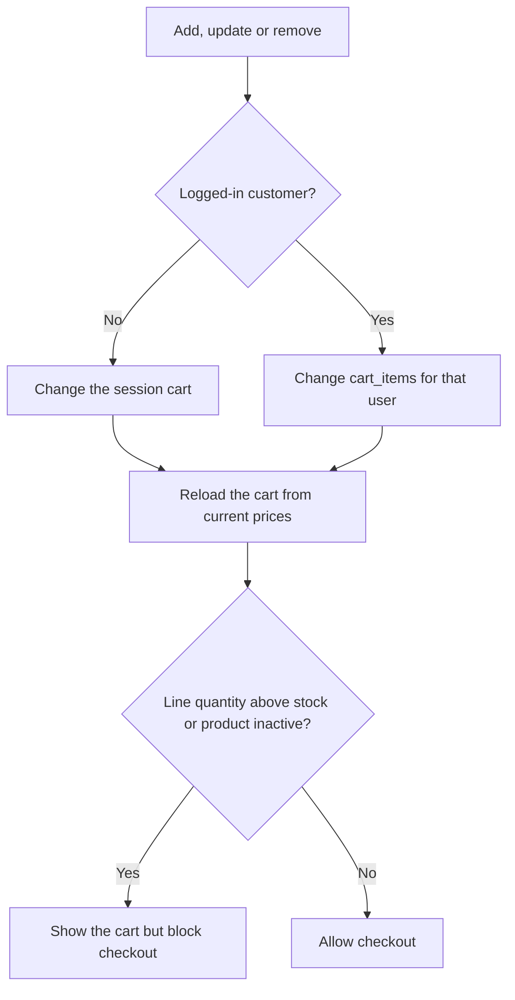
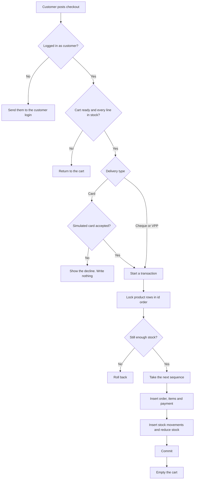
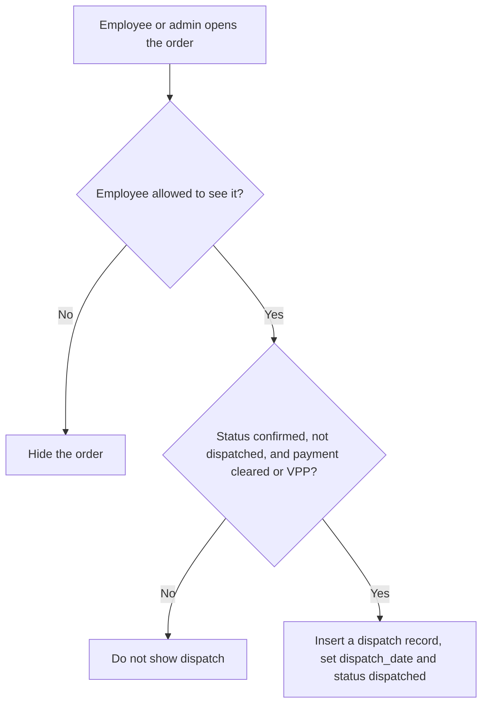
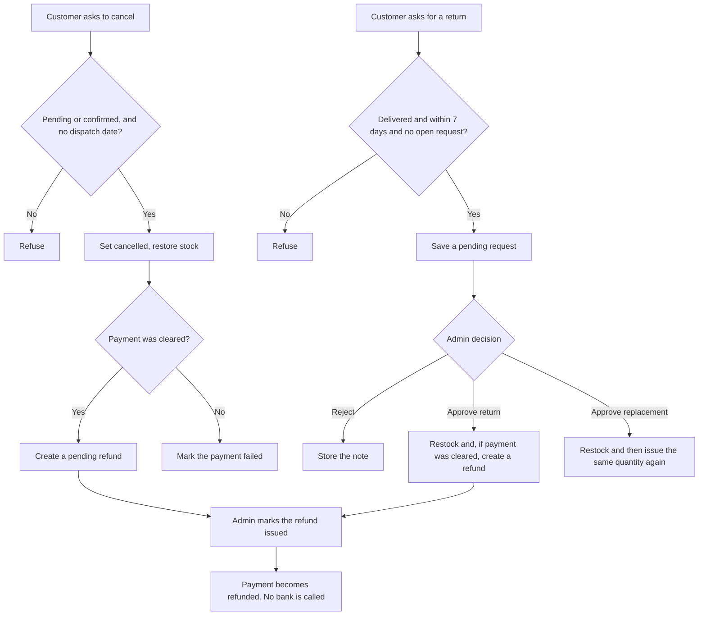

# Algorithms and Flowcharts

The diagrams match the functions in `includes/auth.php`, `includes/cart.php` and `includes/orders.php`.

## Login

The same checks run for the customer, admin and employee forms. Only the expected role changes.

A correct password on the wrong door does not create a session.

## Cart

The browser never sends the line price. `cart_details()` reads `products.price`.

## Checkout and payment

Card success stores status cleared and order status confirmed. Cheque starts as pending and pending. VPP starts as confirmed and payment pending. A decline throws before `place_order()`, so stock is unchanged.

## Dispatch

Delivery is a second step. For unpaid VPP, the delivery report can mark the cash collected in the same transaction. A failed delivery note does not mark the order delivered.

## Cancel, return and refund

